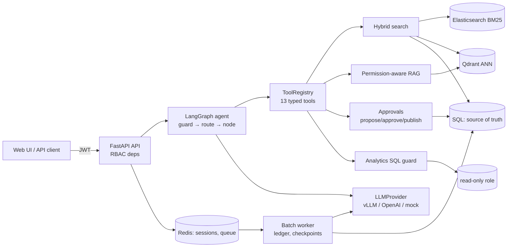

# Interview cheatsheet: NovaPromo on-prem AI platform

A 15-minute review before an interview. Every claim here matches the code. File references point to where the detail lives if you get a follow-up. Deeper material: [`architecture-decisions.md`](architecture-decisions.md), [`local-llm-and-gpu.md`](local-llm-and-gpu.md), [`questions-and-answers.md`](questions-and-answers.md).

---

## 1. The 60-second version (spoken, ~150 words)

> I built an on-prem AI platform for a fictional 25–50 person B2B promotional-products distributor in Slovakia and Czechia. It covers hybrid product search over about a thousand products, permission-aware RAG over internal documents, and an agent that uses typed tools instead of free SQL. It also generates product content behind a human approval step, and it runs a nightly enrichment batch. Content is in Slovak, Czech and English. Production would run on MS SQL Server and one NVIDIA GPU server with vLLM.
>
> The design principle is that the model is never the security boundary. RBAC is enforced at the API, the tool executor and inside the vector index. Retrieved text is treated as untrusted, and every write becomes a change request with separation of duties and an optimistic version check. Every dependency has an embedded fallback, so the whole thing runs on a laptop with a deterministic mock LLM. It has 117 tests and an evaluation harness that measures the gap to a real model.

## 2. The 3-minute version (spoken, ~450 words)

> The scenario is NovaPromo, a fictional distributor of promotional products such as bottles, pens and textiles. It has 25 to 50 employees in Slovakia and Czechia. They have three suppliers whose feeds come as XML, JSON and XLSX, each with a different schema: German colour names, prices in cents, Czech headers with CZK prices. I normalise those at the edge into one canonical model. That gives about 1,044 products, and 7 rows are rejected with reasons instead of being silently imported.
>
> There are four capabilities. First, **hybrid search**. A query like "black metal bottle 750 ml under 15 EUR" is mostly structured, so I extract filters deterministically: colour, a material family, a capacity range of plus or minus 10%, and a price cap. I push those filters into both BM25 in Elasticsearch and ANN in Qdrant. Then I fuse the two lists with Reciprocal Rank Fusion at k=60, rerank the top 30, and finally re-check live stock and status in SQL, because the index can be stale. Exact product codes skip all of that and go straight to a keyword lookup.
>
> Second, **permission-aware RAG**. Documents are parsed by type and keep a locator (page, section, sheet and row) so every citation is precise. Each chunk carries `access_roles`, and the role filter is applied inside the Qdrant query. Chunks are then re-checked, failing closed, so a forbidden chunk never reaches the prompt. Retrieved text is wrapped as untrusted data and scanned for injection patterns.
>
> Third, the **agent**. It's a LangGraph state graph with a deterministic router. It has 13 typed tools, each with a Pydantic input schema, a required permission and a read/write side-effect flag. There's no `execute_sql`. Analytics is admin-only and goes through a sqlglot AST guard, a table allowlist, a row cap, a read-only role and a timeout. Content generation is a loop: generate, validate deterministically, retry once, then propose. Nothing is written directly. A proposal becomes a change request with a payload hash. An admin who isn't the requester approves it, and publishing re-verifies the hash and the product version. If someone edited the product in the meantime, the request goes to `conflict`.
>
> Fourth, a **nightly batch** in a separate worker process. It has an idempotency ledger keyed on the input hash and the prompt version, checkpoints every 25 items, three attempts with exponential backoff, and pause and resume. It only fills empty fields and flags them for review.
>
> For infrastructure, every dependency has a production integration and an embedded fallback: Postgres or SQL Server or SQLite, a Qdrant server or local mode, Elasticsearch or in-process BM25, Redis or an in-memory store, vLLM or a deterministic mock. The same code paths run in CI and on a laptop. The LLM sits behind one interface, and vLLM is reached through its OpenAI-compatible API, so switching to it is a config change.
>
> Finally, I was honest about quality. With the mock provider the evaluation harness shows an overall pass rate of 0.81, but Czech Q&A passes only 0.25. That is exactly why a real model is needed, and the harness is how I'd choose it. The sizing doc works out that a 14B model at 4-bit on one 48 GB GPU gives plenty of KV-cache headroom for this company's load.

---

## 3. Architecture in one diagram

1. **Request path:** a JWT-authenticated request reaches FastAPI. The synchronous agent runs in a threadpool (`apps/api/routers/chat.py`). `guard` scans the message, `route_rules()` picks one of 11 routes, and the route node calls tools only through `ToolRegistry.execute()`.
2. **Governed tools:** the executor rejects unknown tools, checks the permission, validates arguments with Pydantic, catches errors without leaking internals, and audit-logs denied and write calls (`services/agent/registry.py`).
3. **Retrieval:** hybrid search does filter extraction, then BM25 + ANN, then RRF, then rerank, then SQL business rules (`services/search/hybrid.py`). RAG does ANN with an `access_roles` filter, a fail-closed re-check, an injection scan and a context budget (`services/rag/service.py`).
4. **Writes:** only `prepare_product_update` writes, and it creates a pending request. Approve and publish are separate, admin-only steps with a hash check and a version check (`services/agent/approvals.py`).
5. **Offline:** the scheduler enqueues a job id in Redis, the worker does `BRPOP`, and all state (jobs, items, ledger) lives in SQL, so the search indexes are rebuilt from SQL (`services/batch/`).

---

## 4. Why each technology

| Technology | Role here | Why | What I'd not use it for |
|---|---|---|---|
| **FastAPI** | HTTP API, auth dependencies, OpenAPI | Typed request validation with Pydantic, dependency injection for RBAC (`require(permission)`), async edge | CPU-heavy work on the event loop; long batch jobs inside a request |
| **LangGraph** | Agent orchestration (`build_graph()`) | Explicit nodes and edges, typed state, bounded loops, testable nodes; checkpointing and interrupts available later | Simple single-call flows; open-ended "let the model decide the control flow" agents |
| **Qdrant** | Product and document vectors | Filtered ANN (payload filter applied during HNSW traversal), payload indexes, same client in local and server mode, snapshots | System of record; exact-code lookup; facets |
| **Elasticsearch 8** (or OpenSearch) | BM25, exact codes, facets | `asciifolding` for diacritics, `edge_ngram` prefixes, fuzziness, keyword fields, terms aggregations | Source of truth; primary vector store (possible later consolidation) |
| **Redis** | Sessions (1800 s TTL), job queue (`LPUSH`/`BRPOP`), pause flags, nightly guard | Low-latency ephemeral state and coordination | Search database (RAM-bound, weaker analyzers); anything that must survive a flush |
| **MS SQL Server / Postgres / SQLite** (SQLAlchemy) | Products, stock, tiers, approvals, audit, batch ledger | Transactions, constraints, backups; the ERP already lives on SQL Server | Semantic retrieval |
| **vLLM** | Production LLM serving (OpenAI-compatible) | PagedAttention, continuous batching, prefix caching, AWQ/GPTQ/FP8, tool-call parsers | Laptop development (Ollama/llama.cpp are simpler); GGUF |
| **HF TEI** | Embeddings (`bge-m3` / `multilingual-e5`) and reranker (`bge-reranker-v2-m3`) | Small dedicated servers, `/v1/embeddings` and `/rerank` | Generative models |
| **sqlglot** | Analytics SQL AST validation | Real parser: statement type, nodes, tables, functions; rewrites the LIMIT | Being the only defence (the read-only role and timeout are also required) |
| **Pydantic** | Tool inputs, settings, API schemas | Validation before execution; JSON Schema for LLM tools for free | Business authorization (that's RBAC) |
| **Prometheus + Grafana** | Metrics: TTFT, tokens, tool calls, security events, batch | Pull model, histograms, standard on-prem stack | Traces with full prompts (kept in SQL under RBAC) |
| **Docker Compose** | Whole stack, with `monitoring` and `vllm` profiles | One host, one engineer, health checks, restart policies | Multi-node scheduling (K3s would be the step up) |
| **React + Vite** | Web UI | Standard SPA, typed | Anything security-relevant (all checks are server-side) |

---

## 5. Major trade-offs

- **Deterministic rule router over an LLM router** because it is free, fast, testable and can't be steered by document text; cost: misses long-tail phrasings (optional `LLM_ROUTING=true` covers them, restricted to the role's allowed tools).
- **Typed tools over `execute_sql`** because prompts are not a security boundary and raw SQL bypasses RBAC; cost: every new capability needs a schema, a permission and a code review.
- **Hybrid (BM25 + vector) over vector-only** because embeddings can't do arithmetic or match identifiers; cost: two indexes to keep in sync, and more stages.
- **RRF over weighted score blending** because BM25 and cosine scores are on different, query-dependent scales and RRF needs no normalisation or training data; cost: it ignores score magnitude, so a confident top hit gets no extra credit.
- **SQL as source of truth, indexes as derived data** because stock and price must be correct at answer time; cost: one extra SQL round trip per search (at most 30 primary-key lookups).
- **Qdrant over pgvector** because the system of record is SQL Server, not Postgres, and filtered ANN is first-class; cost: one more stateful service (mitigated because it can be rebuilt from SQL).
- **Human approval over direct writes** because customer-facing text gets exported downstream; cost: publishing latency and at least two people with the right roles.
- **Modular monolith over microservices** because of 1–2 maintainers and single-digit RPS; cost: a bug in one module can take down the API process (the batch runs in a separate process).
- **Redis list over Streams/Celery** because the durable state is already in SQL; cost: at-most-once delivery of the job id, which is recovered through `resume_job()`.
- **Local vLLM over a frontier API** because of data residency, predictable cost and no rate limits for batch; cost: GPU capex, a single point of failure, and lower quality for Slovak and Czech copy.
- **Deterministic mock LLM in CI over a small real model** because it is fast, free and reproducible; cost: it proves flow and grounding, not language quality (the evaluation harness covers that).

---

## 6. Security model

| Layer | Mechanism | Where |
|---|---|---|
| **AuthN** | JWT (HS256, 480 min TTL), PBKDF2-SHA256 passwords (120k iterations), constant-time compare | `packages/core/security.py`, `apps/api/deps.py` |
| **RBAC: API** | `require(Permission.X)` dependency; a denial returns 403 and is audit-logged | `apps/api/deps.py` |
| **RBAC: tools** | `ToolRegistry.execute()` checks `principal.can(spec.permission)`; the LLM only ever sees `allowed_for(principal)` | `services/agent/registry.py` |
| **RBAC: data** | Qdrant filter `access_roles MatchAny [role]` inside ANN, plus a fail-closed re-check. Stock numbers are hidden without `stock:read`. Unknown documents default to `management` | `services/rag/service.py`, `services/rag/pipeline.py`, `hybrid._materialize` |
| **Untrusted retrieval** | Chunks wrapped in `<document trust="untrusted">` and HTML-escaped; the system prompt says not to follow instructions in them; regex scan at ingestion and again at query time, with offending sentences redacted | `services/llm/prompts.py`, `services/rag/injection.py` |
| **Tool allowlist** | 13 registered tools. There is no `execute_sql`, no customer export, no e-mail and no direct update. A missing capability is the strongest defence | `services/agent/tools.py` |
| **Argument validation** | Pydantic models: SKU regex `^[A-Za-z0-9.\-]+$`, lengths, enums (`Literal` fields), numeric bounds | `services/agent/tools.py` |
| **Approval boundary** | Pending request; separation of duties; `sha256(sku\|field\|base_version\|new_value)` re-verified at publish; version mismatch goes to `conflict` | `services/agent/approvals.py` |
| **SQL guard** | sqlglot AST, one statement, SELECT only, forbidden nodes and functions, table allowlist, no system schemas, LIMIT ≤ 200, read-only role, 3 s timeout | `services/agent/analytics_sql.py` |
| **Audit** | `audit_log` rows for denials, writes, every approval transition, and analytics SQL (raw and normalised) | registry, approvals, analytics |
| **Least privilege** | Nested roles; the analytics DB user has SELECT on 6 tables; the GPU server sits in its own VLAN with no egress and an API key; only the API and web ports are published | `security.py`, `analytics_sql.apply_readonly_grants`, compose |

One-liner: **the model can be fully jailbroken and still cannot exceed the calling user's permissions**, because authorization happens in code before and after the model, never in the prompt.

---

## 7. RAG in 90 seconds

- **Ingestion** (offline, `services/rag/pipeline.py`): parse by type, keeping a locator (PDF page and section, DOCX heading, XLSX sheet and row via templates, JSONPath, XML path). Then clean (boilerplate, soft hyphens), chunk, scan for injection, embed `title + chunk`, and upsert with the payload `access_roles`, `classification`, `language` and `injection_flagged`. Idempotent: an unchanged SHA-256 means skip; a changed document has its old chunks deleted first.
- **Chunking** (`services/rag/chunking.py`): prose is split on sentence boundaries inside a section, never across headings, at about 800 chars with 1 sentence of overlap, and the heading is prepended. Records (rows, JSON items) are never split or merged.
- **Query** (`RAGService`): embed the question, then ANN top 12 with the role filter, then a fail-closed re-check, then a light rerank (`0.55·vector + 0.35·term overlap + 0.15 heading bonus`), then a budget of 5 chunks or 6,000 chars. Re-scan for injection and redact, then call the LLM with numbered untrusted `<document>` blocks. Citations are parsed from `[n]`.
- **No accessible documents** gives a fixed "I found no documents you are allowed to access" answer in SK/CS/EN, and the LLM is not called.

## 8. Hybrid search in 90 seconds

Pipeline (`services/search/hybrid.py`):
1. `extract_query()` pulls out price (max, min, between, around ±20%), capacity (±10%, or ±15% with "around"/"cca"), size, in-stock, colour, material family, category, supplier, brand and exact code. What remains is the semantic text.
2. An exact code (`NP-10042`, `29904.01`, `PT-4410-NV`, `ECO-xxxx-n`) goes to `find_code()`, which short-circuits the rest.
3. BM25 (query expanded with synonyms) and ANN each return 50 candidates, with the **same filters pushed into both engines**.
4. If both are empty, relax `category` and then `material`, and report `relaxed_filters`. Price, capacity and stock are never relaxed.
5. **RRF, k=60**, then rerank the top 30 (`FeatureReranker`: 0.35 term coverage + 0.40 concept coverage + 0.25 normalised fused score).
6. SQL business rules: drop inactive products, re-check stock, adjust (+0.05 in stock, −0.10 out of stock, −0.05 if lead time > 21 d), hide stock without `stock:read`, and diversify (≤3 per product type at the head of the list).
7. Every hit carries a `RankExplanation` (BM25 and vector rank and score, RRF, rerank, adjustment, matched attributes).

**RRF formula:** `RRF(d) = Σ_i w_i / (k + rank_i(d))`, with rank starting at 1, k = 60 and w_i = 1 by default.

**Worked example (k=60):**

| Product | BM25 rank | Vector rank | RRF |
|---|---|---|---|
| A | 1 | 3 | 1/61 + 1/63 = **0.0323** |
| C | – | 1 | 1/61 = **0.0164** |
| B | 2 | – | 1/62 = **0.0161** |

A > C > B: being found by both retrievers beats being first in only one. A larger k flattens the differences between ranks, and a smaller k makes fusion more winner-takes-all.

## 9. vLLM in 60 seconds

- **PagedAttention:** the KV cache is stored in fixed-size blocks allocated on demand, with no reservation for the maximum length, so many more sequences fit.
- **Continuous batching:** sequences join and leave the batch at every decode step, so short requests don't wait for long ones.
- **Prefix caching:** the shared system prompt's KV blocks are reused. The platform keeps static content first and variable content last to benefit.
- **OpenAI-compatible API:** `VLLMProvider` is the same class as OpenAI, so switching is a config change. Streaming lets the platform measure TTFT itself (`llm_time_to_first_token_seconds`). Tool calls are non-streamed, and need `--enable-auto-tool-choice --tool-call-parser hermes` for Qwen.
- **Mental model:** prefill is compute-bound, so it drives TTFT and grows with RAG context. Decode is memory-bandwidth-bound, so it drives tokens/s. `--gpu-memory-utilization 0.90` preallocates, so `nvidia-smi` showing about 90% at idle is normal.

## 10. Quantization in 60 seconds

Weights ≈ params × bytes/param. **14B model:** FP16/BF16 ≈ **28 GB**, INT8/FP8 ≈ **14 GB**, 4-bit (AWQ/GPTQ) ≈ **7–8 GB**. The published Qwen2.5-14B-AWQ is closer to about 10 GB, because embeddings and the LM head stay in 16-bit.

**KV-cache caveat:** weights are not the whole story. KV per token = 2 × layers × KV heads × head_dim × bytes. For Qwen2.5-14B that is 2 × 48 × 8 × 128 × 2 ≈ **196 KB/token**, so an 8k sequence is about **1.6 GB**, and **10 concurrent 8k chats ≈ 16 GB, more than the 4-bit weights**. Concurrency × context dominates memory. An FP8 KV cache halves it.

Budget on a 48 GB L40S at util 0.90: about 43 GB usable, minus 10 GB weights and 3 GB overhead, leaves **≈30 GB KV ≈ 150k tokens ≈ 37 sequences at 4k**.

Quality: 8-bit is usually within noise. 4-bit costs about 1–3 points in English and often more in Slovak and Czech. Look for missing diacritics, wrong case endings, SK/CS mixing and malformed JSON or tool calls. A bigger model at 4-bit often beats a smaller one at 16-bit, but the evaluation harness decides.

## 11. Scaling: what changes

| Change | What breaks first | What I'd do |
|---|---|---|
| **10× users** (~250–500, ~50–100 concurrent requests) | vLLM KV cache and queue (≈37 × 4k sequences on one card); API threadpool; DB pool | Watch `num_requests_waiting` and preemptions. Add a second vLLM replica behind a load balancer, cap `--max-num-seqs`, use an FP8 KV cache. Run several API containers (they're stateless: JWT, sessions in Redis). Size the DB pool and the anyio thread limit. Stream answers to the UI. Add rate limiting per user |
| **10× products** (~10k) | Barely anything: Qdrant and ES handle millions. The nightly batch grows 10× in LLM calls; the in-process BM25 fallback gets slow | Raise batch concurrency at night (16–32). The ledger makes reruns free. Always use real ES. Consider Qdrant scalar quantization only at millions of vectors. Measure re-index time |
| **Second GPU** | — | For a 14B model, run a **second replica** (HA + throughput) or dedicate it to batch and embeddings. Tensor parallelism only for 32B BF16 or 70B 4-bit |
| **Multiple workers** | Nightly guard already uses atomic `SET NX`; stale `running` jobs are re-queued on worker start via a checkpoint heartbeat; one job is processed by one worker | Add an owner lease on jobs. For intra-job parallelism across workers, claim items with `SELECT … FOR UPDATE SKIP LOCKED`. Move the queue to Redis Streams for acks |

---

## 12. Numbers to remember

| Item | Value |
|---|---|
| Products | ~1,044 from 3 feeds (XML / JSON / XLSX); **7 rows rejected** with reasons |
| Hero product | **NP-10042**: black stainless-steel 750 ml thermal bottle, **12.90 EUR**, **1,620 pcs** across SUPPLIER / BA / ZA (supplier code `29904.01`) |
| Roles | 4: employee ⊂ sales ⊂ catalog_manager ⊂ admin; 15 permissions |
| Tools | **13** typed tools; 1 write-proposal tool plus 2 approval tools |
| Search | RRF **k=60**, 50 candidates per retriever, rerank top **30**, capacity ±10% (±15% with "around"), price "around" ±20% |
| RAG | top_k 12, ≤5 chunks, 6,000-char budget, ~800-char chunks, 1-sentence overlap |
| Content loop | `MAX_CONTENT_ATTEMPTS = 2` (one regeneration), guideline length 350–600 chars |
| Analytics guard | 6 allowlisted tables, LIMIT ≤ **200**, timeout **3,000 ms** |
| Batch | checkpoint every **25**, **3** attempts, exponential backoff, concurrency 4, nightly at 02:00 |
| Sessions | Redis TTL 1,800 s; JWT TTL 480 min |
| Eval (mock) | 82 cases; **overall pass 0.81**, mean 0.88; **cs_qa 0.25**, sk_qa 0.50, search 1.0, routing 1.0 |
| Tests | **117** (unit, integration, security) |
| 14B weights | 28 / 14 / 7–8 GB (FP16 / INT8 / 4-bit); KV ≈ 196 KB/token |
| Default LLM | `max_tokens` 700, temperature 0.2, timeout 60 s |

---

## 13. Twenty likely questions

1. **Why hybrid search and not just embeddings?**
   Most B2B queries carry structured constraints and identifiers, and embeddings neither do arithmetic nor match SKUs reliably. I extract filters deterministically and push them into both BM25 and ANN, then fuse with RRF. Exact codes bypass retrieval entirely.

2. **How is RBAC enforced for RAG?**
   Each chunk stores `access_roles` at ingestion. The Qdrant query filters on the caller's role inside the ANN search, and every returned chunk is re-checked and dropped if the role is missing. Forbidden text never reaches the prompt, so a jailbreak has nothing to leak.

3. **What stops the agent from running arbitrary SQL?**
   There is no SQL tool on the default path, only typed tools with Pydantic inputs and permissions. The admin-only analytics tool parses SQL with sqlglot and allows only one SELECT on 6 allowlisted tables, with no forbidden functions and LIMIT ≤ 200. It runs on a read-only role with a 3 s timeout and is audit-logged.

4. **How do you handle prompt injection?**
   Defence in depth. Retrieved text is wrapped as untrusted and scanned, with injection sentences redacted. The route is chosen by rules before any document is read, tools are RBAC-checked, there is no export tool, and writes need human approval. Detection is a signal; the boundary is capability and authorization.

5. **Why LangGraph?**
   The workflows are known and must be bounded and testable. LangGraph gives explicit nodes and edges, typed state and a bounded retry loop without letting the model decide the control flow. Nodes are plain functions, so lock-in is small.

6. **How does the content workflow work?**
   Gather facts and brand guidelines, generate, then validate deterministically: length, superlatives, prices or stock, supplier names, material, language, injection. If validation fails it regenerates once. It then creates a pending change request, and nothing is written until an admin approves and publishes.

7. **What does approval protect against?**
   Hallucinated content going live, self-approval (separation of duties), tampering after approval (the payload hash is re-verified) and lost updates (an optimistic version check moves the request to `conflict`). Every transition is audited.

8. **Why RRF with k=60?**
   It uses ranks, not scores, so no normalisation is needed between unbounded BM25 scores and cosine similarities. k=60 comes from Cormack et al. and flattens the gap between top ranks, so documents both retrievers agree on win.

9. **Why vLLM?**
   PagedAttention and continuous batching give good concurrency on one GPU, and prefix caching reduces TTFT for the shared system prompt. The OpenAI-compatible API keeps the application vendor-neutral.

10. **Which model and GPU would you pick?**
    Start with Qwen2.5-14B-Instruct at AWQ 4-bit or FP8 on one 48 GB L40S or RTX 6000 Ada. That leaves about 30 GB of KV cache, far above the peak of 5–10 concurrent requests. The evaluation harness on our own SK/CS data makes the final call.

11. **How do you stop the model inventing stock or prices?**
    Stock and price come only from SQL tools, and the answers are formatted by code from tool results. Generated descriptions are validated to contain no prices or stock, and search re-checks live stock in SQL.

12. **How do you evaluate?**
    82 labelled cases across 8 categories: SK and CS Q&A, RAG, descriptions, translation (chrF), filter extraction, tool selection and search precision. Latency and tokens are recorded too. The same run against the mock, and against each vLLM candidate, turns model choice into numbers.

13. **What happens if the batch worker crashes?**
    Completed chunks are already committed, and the ledger plus the "fill empty only" rule make a rerun skip finished work without duplicate LLM calls. The Redis message is lost but the job lives in SQL. The honest gap is that a hard kill leaves the job `running`, and I'd add a heartbeat and stale-job sweeper.

14. **Why Qdrant and not pgvector?**
    The system of record is SQL Server, so pgvector would mean a second relational database just for vectors. Qdrant applies payload filters during graph traversal, which matters for selective RBAC filters. If we were already on Postgres at this scale, pgvector would be a fine choice.

15. **Why not put everything in Elasticsearch?**
    It's a reasonable consolidation option later. I kept vectors in a dedicated engine for more predictable filtered kNN and quantization, and so each index can be rebuilt or replaced independently. Both are derived from SQL anyway.

16. **Why is the API async but the agent sync?**
    The agent does blocking I/O (SQLAlchemy, httpx.Client). `run_in_threadpool` keeps the event loop free, and context variables such as the trace propagate into the thread.

17. **How do you observe it?**
    Prometheus metrics for HTTP, TTFT, LLM latency by task, tokens, tool calls by outcome, security events and batch. Per-request traces with spans are stored in SQL under RBAC, plus vLLM `/metrics` and DCGM for the GPU.

18. **How do you handle Slovak/Czech specifics?**
    Diacritic folding everywhere, a light suffix stemmer, SK/CS vocabulary in the filter rules and router, and ES `asciifolding` plus edge n-grams and fuzziness. Validation checks the output language. Quantization is evaluated specifically for diacritics and SK/CS mixing.

19. **What's the role of Redis?**
    Sessions (`last_sku` for follow-ups), the job queue, pause flags and the nightly guard. It is deliberately not the search database, and losing it loses no business data.

20. **What would you change for production?**
    SSO via OIDC, a SQL Server container in CI for the T-SQL analytics path, owner leases on batch jobs, streaming to the UI, rate limits, real embeddings and a reranker, guided JSON for classification, and a larger evaluation set with native-speaker review.

---

## 14. If I had more time (honest limitations and next steps)

| Limitation in the code today | Production next step |
|---|---|
| `HashingEmbedder` is lexical and concept hashing, not a semantic model | `bge-m3` or `multilingual-e5-large` via TEI. Recreate the collections (a migration, not a config flip). Re-run the evaluation |
| Mock LLM: flat style, heuristic language detection (cs_qa 0.25) | Evaluate Qwen2.5-14B-AWQ, Mistral-Small-24B-FP8 and EuroLLM-9B for translation, then choose on the evaluation data |
| Analytics guard on MS SQL Server: T-SQL dialect (`TOP`) and pyodbc query timeout are implemented, but not exercised against a real SQL Server in CI | Add a SQL Server container to CI; expose analytics through views granted to a `db_datareader` login |
| Retries use short exponential backoff (max 1 s) without jitter; tuned for the demo | Seconds-scale backoff with jitter and a circuit breaker when the GPU server is down |
| Stale-job recovery is heartbeat-based (5 min) at worker start; no owner lease | A lease with an owner id so two workers can never run the same job concurrently |
| Redis list gives at-most-once delivery | Redis Streams with consumer groups, or accept it (SQL is the truth) |
| JWT HS256 with local demo users, no revocation | OIDC with Entra ID / AD, short-lived tokens, roles mapped from groups |
| No rate limiting; no streaming of chat answers to the UI | A per-user token bucket in Redis; SSE streaming |
| No request priorities to vLLM | `--scheduling-policy priority`, sending priority in `_body()` |
| `json_schema` supported but unused (classification parses free JSON) | Guided decoding for classification and the LLM filter extractor |
| Synonyms applied in the application | ES `synonym_graph` with an updateable synonym set owned by the business |
| Evaluation is keyword and chrF based, 82 cases | More cases, LLM-as-judge for groundedness (calibrated), blind native review of 30–50 SK/CS samples, and a regression gate before switching models |
| ES security disabled in compose; vLLM `/metrics` has no authentication | TLS and auth on ES; network policy for metrics ports |
| The application only mirrors vLLM KV usage (`llm_kv_cache_usage_ratio`) and has no GPU-utilization gauge; `local-llm-and-gpu.md` still uses older metric names | Take utilization from DCGM (`DCGM_FI_PROF_SM_ACTIVE`); align the doc with the code |
