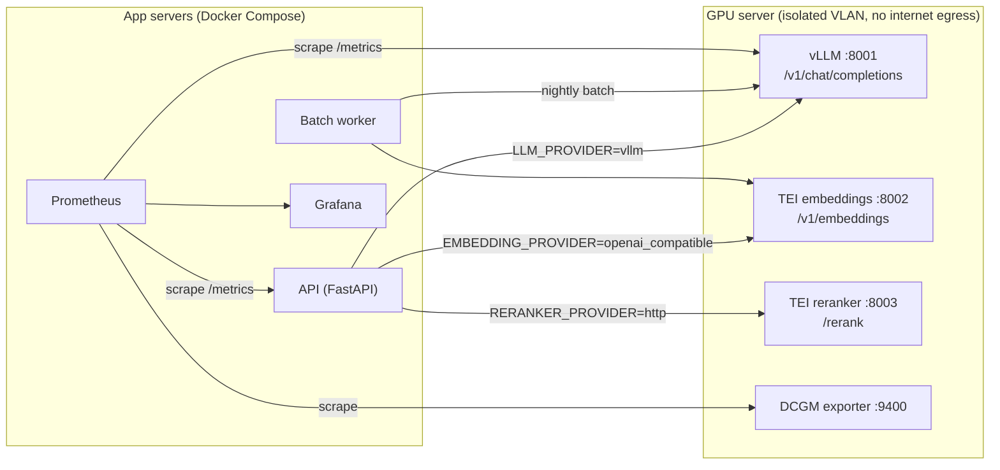
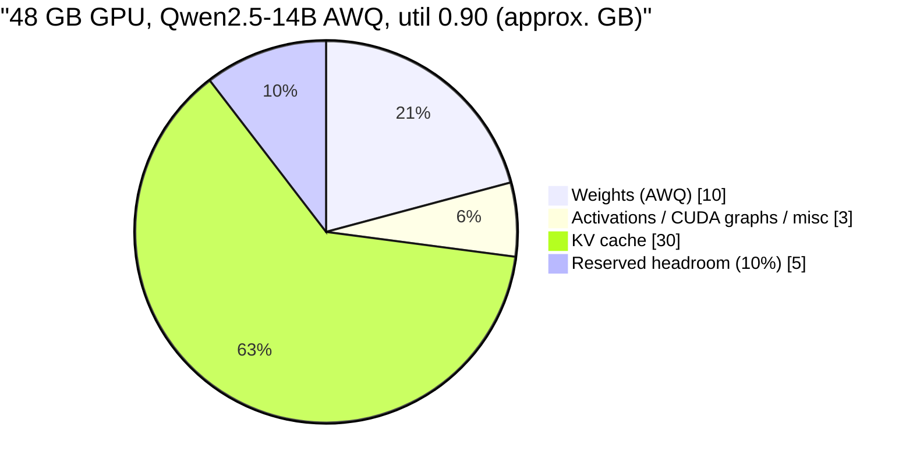
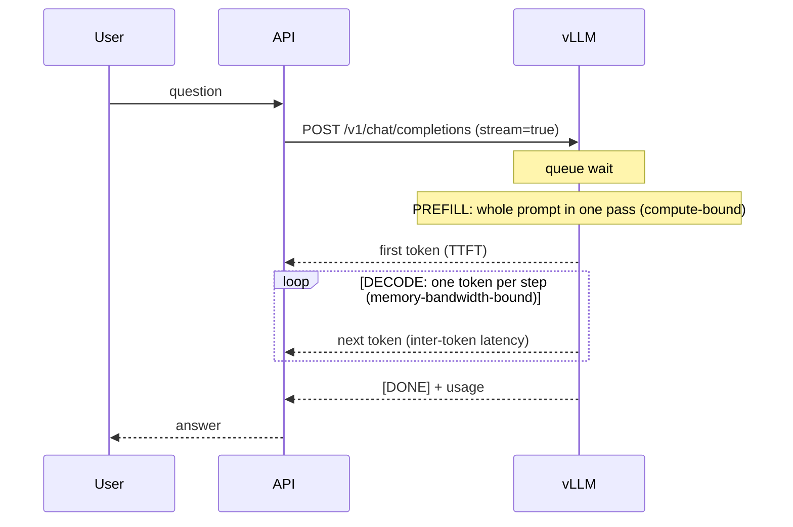

# On-prem inference: GPU sizing and vLLM

This document covers how to size, deploy and operate the NovaPromo platform's LLM, embedding and reranking inference on the company's own NVIDIA GPU server. The background decision is in [ADR-008](architecture-decisions.md#adr-008-local-vllm-compatible-inference).

> **All numbers here are approximate.** They are back-of-the-envelope estimates meant to get you to the right order of magnitude and the right GPU class. Real figures depend on the exact checkpoint, the vLLM version, kernels, prompt shapes and drivers. Before buying hardware or committing to an SLO, measure with `vllm bench serve` (or the benchmark scripts shipped with vLLM) and the repository's evaluation harness (`evaluations/`).

---

## 1. Where inference sits in the platform



The application never imports a model SDK. Everything goes through `LLMProvider` (`services/llm/base.py`), and the vLLM client is `VLLMProvider` in `services/llm/openai_compat.py`. That client is the same class used for OpenAI, because vLLM exposes the OpenAI API.

---

## 2. Memory: weights

**Rule of thumb: weight memory ≈ parameters × bytes per parameter.**

| Precision | Bytes / param | 14B example |
|---|---|---|
| FP16 / BF16 | 2 | 14 × 2 ≈ **28 GB** |
| INT8 / FP8 | 1 | 14 × 1 ≈ **14 GB** |
| 4-bit (AWQ / GPTQ) | ~0.5 (+ scales/zeros) | 14 × 0.5 ≈ **7–8 GB** |

| Model class (examples) | Params | BF16 | INT8 / FP8 | 4-bit (AWQ / GPTQ) |
|---|---|---|---|---|
| 7B / 8B (Qwen2.5-7B, Llama-3.1-8B) | 7.6–8.0 B | ~15–16 GB | ~8 GB | ~4.5–5.5 GB |
| 14B (Qwen2.5-14B) | 14.7 B | ~28–30 GB | ~15 GB | ~7.5–8.5 GB |
| 24B (Mistral-Small-24B) | 24 B | ~48 GB | ~24 GB | ~13–14 GB |
| 32B (Qwen2.5-32B) | 32.8 B | ~65 GB | ~33 GB | ~17–19 GB |
| 70B (Llama-3.1-70B) | 70.6 B | ~141 GB | ~71 GB | ~37–40 GB |

**These are weights only.** They exclude the KV cache, activations, CUDA graphs and allocator fragmentation, all covered below. Two further caveats:

- 4-bit checkpoints usually keep the embedding and LM-head matrices in 16-bit. For models with large vocabularies (Qwen's ~152k tokens), that adds 1–2 GB. The published `Qwen2.5-14B-Instruct-AWQ` checkpoint is therefore closer to **~10 GB** on disk than to 7 GB.
- "Fits in VRAM" is not the goal. **Weights plus enough KV cache for your concurrency** is the goal. A model that only just fits serves one short request at a time.

---

## 3. Memory: KV cache (what actually limits concurrency)

During generation every token of every in-flight sequence keeps its keys and values for every layer:

```
KV bytes per token = 2 (K and V) × num_layers × num_kv_heads × head_dim × bytes_per_element
```

**Worked example: a Qwen2.5-14B-like configuration** (48 layers, 8 KV heads via grouped-query attention (GQA), head_dim 128, FP16 cache):

```
2 × 48 × 8 × 128 × 2 bytes = 196,608 bytes ≈ 196 KB per token

 4k-token sequence  ≈ 0.8 GB
 8k-token sequence  ≈ 1.6 GB
16k-token sequence  ≈ 3.2 GB
```

GQA is doing a lot of work here. With full multi-head attention (40 KV heads instead of 8), the same model would need about 5× more cache per token.

The consequence is **concurrency × context length dominates memory, not the model**. Ten concurrent 8k-token conversations need about 16 GB of KV cache, more than the 4-bit weights of the model itself.

Approximate per-token KV cost for the candidate models (FP16 cache; check `config.json` of the exact checkpoint):

| Model | Layers | KV heads | head_dim | KV / token | 8k sequence |
|---|---|---|---|---|---|
| Qwen2.5-7B | 28 | 4 | 128 | ~57 KB | ~0.47 GB |
| Llama-3.1-8B | 32 | 8 | 128 | ~131 KB | ~1.1 GB |
| Qwen2.5-14B | 48 | 8 | 128 | ~196 KB | ~1.6 GB |
| Mistral-Small-24B | 40 | 8 | 128 | ~164 KB | ~1.3 GB |
| Qwen2.5-32B | 64 | 8 | 128 | ~262 KB | ~2.1 GB |
| Gemma-2-9B | 42 | 8 | 256 | ~344 KB | ~2.8 GB |
| Llama-3.1-70B | 80 | 8 | 128 | ~328 KB | ~2.7 GB |

**FP8 KV cache** (`--kv-cache-dtype fp8`) halves this (for example ~98 KB/token for the 14B), which roughly doubles the number of tokens that fit. The quality impact is usually small but not zero, so evaluate it like any other quantization (section 9). It is most attractive on Ada and Hopper GPUs.

---

## 4. Runtime overhead and `--gpu-memory-utilization`

On top of weights and KV cache, vLLM needs:

- **activation and workspace memory** for the largest batch it will run (sized by a profiling pass at startup),
- **CUDA graphs** captured for common batch sizes (a few hundred MB to about 1–2 GB, depending on model and settings; `--enforce-eager` disables them at a latency cost),
- the CUDA context, NCCL buffers with tensor parallelism, and some **fragmentation** headroom.

Budget roughly **2–4 GB** for this on a single GPU.

vLLM **preallocates** memory. `--gpu-memory-utilization 0.90` means "this process may use 90% of total VRAM". After loading weights and profiling activations, everything left inside that 90% becomes KV-cache blocks. Practical consequences:

- `nvidia-smi` shows about 90% memory used even when idle. That is expected and is not a leak.
- If other processes share the GPU (TEI embeddings, the reranker), lower the fraction (for example `0.80`) so they fit. Several vLLM instances on one GPU need fractions that add up to less than 1.
- At startup vLLM logs the number of KV-cache blocks and the **maximum concurrency** for `max-model-len`. Read that line. It is your real capacity number.

**Worked budget: Qwen2.5-14B-Instruct-AWQ on one 48 GB GPU (L40S / RTX 6000 Ada), utilization 0.90:**

```
usable            0.90 × 48 GB  ≈ 43 GB
weights (AWQ)                   ≈ 10 GB
activations + graphs + misc     ≈  3 GB
KV cache                        ≈ 30 GB  →  30 GB / 196 KB ≈ 150k tokens in flight
                                          ≈ 37 concurrent sequences at 4k tokens
                                          ≈  9 concurrent sequences at the full 16k
```



---

## 5. Why vLLM: continuous batching, PagedAttention, prefix caching

A naive `transformers` `model.generate()` server handles one request (or one static batch) at a time. It reserves KV memory for the **maximum** length of every sequence up front, and a batch finishes only when its longest member finishes. GPU utilization during decode is poor, and memory is wasted on reservations that are never used.

vLLM addresses this with three mechanisms:

- **PagedAttention.** The KV cache is split into fixed-size blocks (like virtual-memory pages) that are allocated on demand as a sequence grows. There is almost no internal fragmentation and no per-request reservation for the maximum length, so many more sequences fit in the same memory.
- **Continuous (in-flight) batching.** The scheduler adds new requests and removes finished ones **at every decode step**. A short request does not wait for a long one, and the GPU works on a full batch most of the time. For 5–10 concurrent users this is the difference between queueing and near-flat latency.
- **Prefix caching** (`--enable-prefix-caching`). KV blocks for an identical prompt prefix are reused across requests. Every platform prompt starts with the same system prompt (`SYSTEM_BASE` in `services/llm/prompts.py`), and batch prompts share long instruction headers. With prefix caching, that part of the prefill is computed once and later requests skip it, which directly reduces TTFT. To benefit, keep static content (system prompt, guidelines) **at the start** of the prompt and variable content (retrieved chunks, the user question) at the end. The platform's prompt builders follow this order.

When memory runs out, vLLM **preempts** sequences (recomputes or swaps them later). Rising `num_preemptions` means the KV cache is too small for the load. Add memory, shorten `max-model-len`, cap `--max-num-seqs`, or use an FP8 KV cache.

---

## 6. Latency: TTFT, inter-token latency, throughput



| Metric | Meaning | Dominated by |
|---|---|---|
| **TTFT** (time to first token) | queue wait + prefill of the whole prompt | prompt length (RAG context), GPU compute (FLOPs), queue depth, prefix-cache hits |
| **ITL / TPOT** (inter-token latency) | time between streamed tokens for one user | memory bandwidth (weights + KV are read every step), batch size |
| **Tokens/s per user** | ≈ 1 / ITL | same as ITL; perceived "typing speed" (reading speed is about 5–10 tokens/s) |
| **Aggregate throughput** | total tokens/s across all sequences | batch size; grows with concurrency until compute-bound or KV-bound |
| **E2E latency** | TTFT + output_tokens × ITL | output length (cap `max_tokens`; the platform default is 700) |

**Prefill vs decode, with rough numbers** (14B, one 48 GB Ada-class GPU):

- *Prefill* costs about 2 × params FLOPs per prompt token. A 4k-token RAG prompt is about 2 × 14.7e9 × 4096 ≈ 1.2e14 FLOPs. At a realistic 60–90 TFLOPS effective, that is roughly **1.5–2 s TTFT** without cache hits. Prefix caching of a 1k-token system prompt removes about a quarter of that. On an H100 the same prefill takes about 0.3–0.5 s.
- *Decode* reads all weights once per step (shared across the batch). The single-stream ceiling is about memory bandwidth ÷ weight bytes: 864 GB/s ÷ ~10 GB ≈ **~85 tokens/s theoretical**, and **~40–70 tokens/s** is realistic for one user. With 10 concurrent sequences, per-user speed drops moderately while aggregate throughput rises several-fold, which is the point of batching.
- A useful mental model: **prefill is compute-bound, decode is bandwidth-bound**. Long RAG contexts hurt TTFT. Large models on low-bandwidth GPUs (L4: ~300 GB/s) hurt tokens/s.

**How the platform measures this.** `OpenAICompatibleProvider._complete()` streams (`stream: true`, `stream_options.include_usage`) for all non-tool calls. It records **TTFT on the first content delta** and takes token counts from the final usage chunk (with an estimate as fallback). `LLMProvider.complete()` exports:

- `llm_time_to_first_token_seconds{provider,model}` (histogram),
- `llm_request_duration_seconds{provider,model,task}` (histogram; `task` is `rag_answer`, `product_description`, `translate`, `classify`, `route`, ...),
- `llm_tokens_total{provider,model,direction}` (counter),

on the API's `/metrics` endpoint, and it also writes TTFT and tokens into the per-request trace. Tool-calling requests (the LLM router) are non-streamed, so they have no TTFT. The client-side TTFT includes network and queue time. Comparing it with vLLM's own `vllm:time_to_first_token_seconds` separates "slow GPU" from "slow network or proxy".

---

## 7. Concurrency sizing for NovaPromo

**Assumptions** (validate with real usage after launch):

- 25–50 employees, of whom perhaps 15–30 use the assistant on a given day.
- **Peak ~5–10 concurrent in-flight chat requests** (users think and read between messages, so concurrent *requests* are much fewer than concurrent *users*).
- A typical chat request is a ~1k system prompt + up to ~2–3k RAG context + question, so **~3–4k input** and **~300–500 output**. Sequences rarely approach 16k.
- **Nightly batch:** enrichment of products with missing SK/CS content. Per product there are up to 3 LLM calls (generate SK, translate SK→CS, classification check).

**Interactive peak (14B AWQ, 48 GB GPU):** 10 sequences × ~4.5k tokens ≈ 45k tokens ≈ **~9 GB KV**, against the ~30 GB available (section 4). There is ample headroom: requests do not queue, and TTFT is dominated by prefill (~1–2 s). The same load on a **24 GB** GPU (~9–10 GB KV left after weights and overhead) fits, but only just. Long documents or a batch running at the same time would push it into queueing and preemption.

**Nightly batch (illustrative):** 2,000 products × (~1.8k input + ~0.6k output tokens across the three calls) ≈ 3.6M prompt tokens + 1.2M generated tokens.

- At the default `BATCH_CONCURRENCY=4`, aggregate decode on a 48 GB Ada GPU is perhaps ~150–250 tokens/s, so **~1.5–2.5 h**.
- Raising concurrency at night to 16–32 (the GPU is otherwise idle) could reach ~500–1,000 tokens/s aggregate, so **~30–60 min**.
- Either way the job finishes well before business hours. The idempotency ledger means a second night over unchanged data costs nothing (ADR-010).

**Contention rule:** run the batch at night (`BATCH_SCHEDULE_HOUR=2`). If daytime batch runs become necessary, start vLLM with `--scheduling-policy priority` and send interactive requests with higher priority, or dedicate a second GPU or instance to batch. The platform does not send request priorities yet. It is a small change in `OpenAICompatibleProvider._body()`.

**Starting point:** one 48 GB GPU (L40S or RTX 6000 Ada) serving a 14B-class instruct model at 4-bit or FP8, `max-model-len 16384`, with the embedding and reranker models on the same GPU (about 1–1.5 GB each at FP16 for `bge-m3` / `bge-reranker-v2-m3`) and vLLM at `--gpu-memory-utilization 0.80–0.85` to leave room for them.

---

## 8. Tensor parallelism vs pipeline parallelism: when you need two GPUs

| | Tensor parallelism (`--tensor-parallel-size N`) | Pipeline parallelism (`--pipeline-parallel-size N`) |
|---|---|---|
| Split | each layer's weight matrices across GPUs | contiguous groups of layers per GPU |
| Communication | all-reduce **every layer, every token** | activations passed between stages once per step |
| Interconnect | wants NVLink; PCIe works for TP=2 with some loss | tolerant of PCIe and multi-node |
| Latency | **lower** per token (work runs in parallel) | not lower for a single request (stages run in sequence); throughput comes from keeping stages busy |
| Typical use | 2–8 GPUs in one server | multi-node, or when TP communication is the bottleneck |

**When NovaPromo would need two GPUs:**

- a model that does not fit with useful KV headroom on one card: **70B at 4-bit** (~40 GB weights) on 2 × 48 GB, or **32B in BF16** (~65 GB) on 2 × 48 GB. Use TP=2.
- high availability (one GPU or server failing should not stop the assistant). This calls for **two replicas** (data parallel) behind a load balancer, not TP.
- isolating batch from interactive: one GPU per workload, again **not** TP.

For a 14B-class model, a second GPU is usually better spent as a **second replica** or for batch and embeddings than on TP=2.

---

## 9. Quantization options and quality, especially for Slovak and Czech

| Method | What it is | vLLM | Notes |
|---|---|---|---|
| **AWQ** (4-bit, weight-only) | activation-aware per-group weight quantization | yes (Marlin kernels on Ampere+) | Common default for "big model on small GPU"; many pre-quantized checkpoints. If you omit `--quantization`, vLLM detects AWQ from the checkpoint and picks the faster `awq_marlin` kernel. Forcing `--quantization awq` may select the slower non-Marlin kernel in some versions, so check the startup log. |
| **GPTQ** (4/8-bit, weight-only) | second-order, layer-wise weight quantization | yes (Marlin / Machete) | Similar quality to AWQ at 4-bit; the 8-bit variant is near-lossless. |
| **FP8** (W8A8) | 8-bit float weights and activations | yes; native on **Ada / Hopper** | Near-lossless for most models, halves memory versus BF16, and speeds up compute on L4/L40S/RTX 6000 Ada/H100. Either pre-quantized checkpoints (e.g. via `llm-compressor`) or dynamic `--quantization fp8` from a BF16 checkpoint. On A100 (Ampere) only weight-only FP8 via Marlin is available, with the memory benefit but no compute speedup. |
| **INT8** (W8A8, SmoothQuant) | 8-bit integer weights and activations | yes | The Ampere-friendly 8-bit alternative. |
| **GGUF** (llama.cpp formats) | CPU / consumer-GPU-oriented formats | experimental | **Not for vLLM production.** Use llama.cpp or Ollama if you need GGUF (developer laptops); use AWQ, GPTQ or FP8 on the server. |
| bitsandbytes (NF4/INT8) | on-the-fly quantization at load | yes | Convenient for experiments; slower than AWQ/GPTQ kernels. |

**Quality impact.** As a rough guide: 8-bit (FP8/INT8) is typically within noise of BF16. 4-bit usually costs about 1–3 points on English benchmarks, and **often more for lower-resource languages and for long-form generation**. Calibration sets for AWQ/GPTQ are predominantly English. Slovak and Czech are both morphologically rich (cases, gender agreement, diacritics), so the failure modes to look for after quantizing are:

- missing or wrong diacritics ("flasa" instead of "fľaša"),
- wrong case endings or gender agreement in longer sentences,
- **SK/CS mixing**: Czech words or forms drifting into Slovak output and vice versa (the languages are close, and weaker models blur them),
- degraded instruction following (length limits, "no superlatives", required mention of material and colour, all checked by `services/agent/validation.py`),
- tool-call and JSON formatting errors (malformed arguments).

A common heuristic is that **a larger model at 4-bit often beats a smaller model at 16-bit** of the same memory footprint (for example 14B-AWQ versus 7B-BF16). It is a heuristic, not a law, and it is exactly what the evaluation harness should decide.

**How to decide: evaluate, don't guess.** Point the platform at each candidate (`LLM_PROVIDER=vllm`, `VLLM_MODEL=...`) and run the evaluation harness in `evaluations/`. Compare, per configuration:

- RAG groundedness and citation correctness on SK/CS/EN questions,
- content-validation pass rate and retry rate for generated SK descriptions,
- SK→CS translation quality (automatic metrics plus a **blind native-speaker review of ~30–50 samples**; automatic metrics are weak at catching SK/CS mixing),
- routing and tool-calling accuracy (if `LLM_ROUTING=true`),
- TTFT p50/p95 and tokens/s from the platform's Prometheus metrics.

Reports go to `evaluations/reports/`. Keep them. They are the evidence behind the model choice and the baseline for the next upgrade.

---

## 10. Trade-off summary

| Lever | Quality | Latency | VRAM | Concurrency |
|---|---|---|---|---|
| Bigger model (14B → 32B) | ↑ (especially SK/CS fluency, reasoning) | ↑ TTFT and ITL (~2×) | ↑ weights ~2×, ↑ KV/token | ↓ |
| BF16 → FP8 weights | ≈ (small loss) | ↓ on Ada/Hopper | ↓ ~50% | ↑ (more KV room) |
| BF16 → 4-bit AWQ/GPTQ | ↓ small to moderate; check SK/CS | ≈ / ↓ decode (fewer bytes read) | ↓ ~70% | ↑↑ |
| FP8 KV cache | ≈ (small loss) | ≈ | ↓ KV ~50% | ↑ ~2× tokens in flight |
| Longer `--max-model-len` | ↑ for long documents | ↑ TTFT for long prompts | ↑ worst-case KV per sequence | ↓ at full length |
| Larger RAG context (more chunks) | ↑ recall, ↓ possible dilution | ↑ TTFT (prefill) | ↑ KV | ↓ |
| Prefix caching | = | ↓ TTFT on shared prefixes | uses KV blocks (evictable) | ≈ / ↑ |
| Higher `--max-num-seqs` | = | ↑ ITL per user under load | ↑ KV pressure | ↑ aggregate throughput |
| TP=2 | = (enables bigger models) | ↓ per token | model split across 2 GPUs | ↑ |

---

## 11. Hardware options

Approximate specifications; "fits" assumes a single GPU, vLLM, and enough KV headroom for about 5–10 concurrent ~4k-token chats.

| GPU | VRAM | Mem. bandwidth | FP8 | Power | Comfortable fits | Notes |
|---|---|---|---|---|---|---|
| **RTX 4090** | 24 GB | ~1.0 TB/s | yes (Ada) | 450 W | 7–8B BF16 (short context), 7–8B FP8, **14B AWQ** | Cheap and fast for a PoC. Consumer card: NVIDIA's GeForce driver licence restricts datacenter deployment, no ECC, 3–4 slots, no server-vendor support. Not recommended as the production server. |
| **L4** | 24 GB | ~0.3 TB/s | yes | 72 W | 7–8B FP8/AWQ; 14B AWQ works but decodes slowly (~20–30 tok/s single stream) | Low power, single-slot, passive. Good for **embeddings and reranker** or a small model; bandwidth-limited for chat on larger models. |
| **L40S** | 48 GB | ~0.86 TB/s | yes | 350 W | **14B AWQ/FP8 with large KV**, 14B BF16, 24B FP8, 32B AWQ | Datacenter card (passive, needs server airflow). **Sweet spot for NovaPromo.** 70B 4-bit technically loads but leaves almost no KV. |
| **RTX 6000 Ada** | 48 GB | ~0.96 TB/s | yes | 300 W | same as L40S | Workstation card with active cooling; fits a tower server without datacenter airflow. ECC. |
| **A100 80 GB** | 80 GB | ~2.0 TB/s | no (weight-only FP8 via Marlin) | 300–400 W | 32B INT8/FP8-weight, 32B AWQ with large KV, 70B AWQ | Excellent bandwidth; older generation, often available refurbished. |
| **H100 80 GB** | 80 GB | ~2.0 (PCIe) – 3.35 (SXM) TB/s | yes | 350–700 W | 32B FP8 with large KV, 70B AWQ; 70B FP8 needs 2 GPUs for KV room | Fastest option, and far more than this workload needs. Worth it only if the model or user count grows significantly. |

Also plan for CPU RAM of at least the model size (for loading), fast NVMe for the model cache, and a UPS. Keep a spare-parts or replacement plan, because a single GPU server is a single point of failure (ADR-008).

---

## 12. Model candidates for SK / CS

**These are candidates to evaluate, not a ranking.** Model generations move quickly, and by the time you read this newer releases in the same families (Qwen, Llama, Mistral, Gemma, EuroLLM) should be added to the list. The selection method in section 9 stays the same.

| Candidate | Size | Why consider | Watch out for | Tool-call parser (vLLM) |
|---|---|---|---|---|
| Qwen2.5-7B-Instruct | 7.6B | strong for size; Apache 2.0; 32k context; good JSON/tool use | SK/CS fluency noticeably below the 14B | `hermes` |
| **Qwen2.5-14B-Instruct** | 14.7B | good quality/VRAM balance; default candidate on 24–48 GB | verify SK vs CS separation | `hermes` |
| Qwen2.5-32B-Instruct | 32.8B | clearly better long-form writing and reasoning | needs 48 GB at 4-bit or 80 GB at 8-bit | `hermes` |
| Llama-3.1-8B-Instruct | 8.0B | broad ecosystem; 128k context | Slovak and Czech not among officially supported languages; Llama community licence | `llama3_json` |
| Llama-3.1-70B-Instruct | 70.6B | strongest in this list for reasoning | 2 GPUs or 80 GB at 4-bit; licence | `llama3_json` |
| Mistral-Small-24B-Instruct | 24B | Apache 2.0; good European-language coverage; efficient | 24B at FP8 needs 48 GB | `mistral` |
| Gemma-2-9B / 27B-it | 9B / 27B | good multilingual quality for size | 8k context; large KV per token (see table); no native tool-call format (use guided JSON); Gemma terms | n/a |
| EuroLLM-9B-Instruct | 9B | trained specifically on all EU official languages incl. SK and CS; Apache 2.0 | smaller context and weaker reasoning and tool use than general-purpose peers; good translation baseline | n/a |

Embeddings and reranking: `BAAI/bge-m3` (1024-dim, multilingual, 8k input) or `intfloat/multilingual-e5-large` (1024-dim; the platform automatically adds the `query:` / `passage:` prefixes for e5 models), and `BAAI/bge-reranker-v2-m3` for reranking.

---

## 13. Deployment

### vLLM on the GPU server

```bash
vllm serve Qwen/Qwen2.5-14B-Instruct-AWQ \
  --quantization awq \
  --max-model-len 16384 \
  --gpu-memory-utilization 0.90 \
  --enable-prefix-caching \
  --enable-auto-tool-choice --tool-call-parser hermes \
  --api-key "${VLLM_API_KEY}" \
  --port 8001
```

- `--enable-auto-tool-choice --tool-call-parser hermes` is required for the optional LLM router (`LLM_ROUTING=true`), which sends OpenAI-style `tools` with `tool_choice: "auto"`. Qwen2.5 emits Hermes-style tool calls.
- `--quantization awq`: see the kernel note in section 9. Omitting the flag lets vLLM auto-select `awq_marlin`.
- Worth considering: `--max-num-seqs 32` (bounds per-user latency under load), `--kv-cache-dtype fp8` (more KV room), `--served-model-name` (a stable alias so `VLLM_MODEL` does not change when the checkpoint does), and pinning the model revision.
- Structured output: `LLMProvider.complete(..., json_schema=...)` maps to `response_format: {type: "json_schema", ...}`, which vLLM enforces with guided decoding. No caller passes a schema yet (the batch classification check parses JSON from plain text). Switching it over is the obvious hardening step for weaker or quantized models that sometimes produce malformed JSON.
- Lower `--gpu-memory-utilization` to about 0.80 if TEI embeddings or the reranker share the GPU.

### Embeddings and reranker (Hugging Face TEI)

```bash
# embeddings: OpenAI-compatible /v1/embeddings
docker run --gpus all -p 8002:80 -v /srv/models:/data \
  ghcr.io/huggingface/text-embeddings-inference:<tag-for-your-gpu-arch> \
  --model-id BAAI/bge-m3

# reranker: /rerank returning [{index, score}], which HttpReranker expects
docker run --gpus all -p 8003:80 -v /srv/models:/data \
  ghcr.io/huggingface/text-embeddings-inference:<tag-for-your-gpu-arch> \
  --model-id BAAI/bge-reranker-v2-m3
```

TEI image tags are built per GPU architecture (Ada, Ampere, Hopper, CPU). Pick the matching one. vLLM can also serve embedding models (`/v1/embeddings`) if you prefer a single serving stack.

### Application configuration (`.env`)

```dotenv
# LLM
LLM_PROVIDER=vllm
VLLM_BASE_URL=http://gpu-server:8001/v1
VLLM_MODEL=Qwen/Qwen2.5-14B-Instruct-AWQ
VLLM_API_KEY=<same key as vllm --api-key>
LLM_ROUTING=false            # true = LLM tool-calling router (restricted to the role's allowed tools)

# Embeddings (TEI or vLLM, OpenAI-compatible)
EMBEDDING_PROVIDER=openai_compatible
EMBEDDING_BASE_URL=http://gpu-server:8002/v1
EMBEDDING_MODEL=BAAI/bge-m3
EMBEDDING_DIM=1024           # must match the model

# Reranker (TEI)
RERANKER_PROVIDER=http
RERANKER_URL=http://gpu-server:8003/rerank
RERANKER_MODEL=BAAI/bge-reranker-v2-m3
```

**Changing the embedding model is a re-index, not a config flip.** The Qdrant collections must be recreated with the new dimension, and all products and document chunks must be re-embedded. Document ingestion skips files whose SHA-256 has not changed, so the document collection must be rebuilt explicitly. In the demo, `python scripts/bootstrap_demo.py --reset` rebuilds everything. Do not run `--reset` against a production database: it drops the SQL tables.

Health check: `VLLMProvider.health()` calls `GET /v1/models`.

### Docker Compose `vllm` profile

For a single-host setup (demo, or when the GPU is in the same machine as the app), the Docker Compose file has an opt-in **`vllm` profile** with a service `vllm` based on the official `vllm/vllm-openai` image and an NVIDIA **GPU reservation** (`deploy.resources.reservations.devices` with `driver: nvidia`, `capabilities: [gpu]`). It needs the NVIDIA Container Toolkit on the host. It is not started by default, so the laptop and CPU demo is unaffected:

```bash
docker compose --profile vllm up -d vllm
# then in .env: LLM_PROVIDER=vllm, VLLM_BASE_URL=http://vllm:8001/v1
```

In production the GPU server is a separate host (section 1), and the app servers only need `VLLM_BASE_URL` pointing at it.

---

## 14. Monitoring

Three sources, all scraped by Prometheus and shown in Grafana:

**1. vLLM `/metrics`** (same port as the API; Prometheus text format):

| Metric | Use |
|---|---|
| `vllm:gpu_cache_usage_perc` (named `vllm:kv_cache_usage_perc` in recent versions) | KV-cache fill. Sustained > 0.9 means you are near preemption. |
| `vllm:num_requests_running` / `vllm:num_requests_waiting` | Batch size and **queue depth**. Waiting > 0 for minutes during business hours means under-provisioned or batch contention. |
| `vllm:time_to_first_token_seconds` (histogram) | Server-side TTFT, p50/p95 |
| `vllm:time_per_output_token_seconds` / `vllm:inter_token_latency_seconds` (histogram) | Decode speed per user |
| `vllm:e2e_request_latency_seconds`, `vllm:request_queue_time_seconds` | End-to-end and queueing time |
| `vllm:prompt_tokens_total`, `vllm:generation_tokens_total` | Throughput (take `rate()`) |
| `vllm:num_preemptions_total` | KV pressure |
| prefix-cache hit/query counters | Is the shared system prompt actually being reused? |

Metric names change between vLLM versions, so check `/metrics` of the deployed version. `VLLMProvider.gpu_stats()` parses both `vllm:kv_cache_usage_perc` and the older `vllm:gpu_cache_usage_perc` (normalised to `kv_cache_usage`), plus `vllm:num_requests_running` and `vllm:num_requests_waiting`. `GET /api/metrics/summary` calls it and mirrors the KV-cache usage into the platform gauge `llm_kv_cache_usage_ratio`. After a vLLM upgrade that renames metrics again, extend the name map there.

**2. NVIDIA DCGM exporter** (`dcgm-exporter`, default port 9400) for the hardware:

- `DCGM_FI_DEV_GPU_UTIL`: coarse "a kernel was running" utilization. It shows about 100% even for inefficient workloads, so prefer `DCGM_FI_PROF_SM_ACTIVE` / `DCGM_FI_PROF_DRAM_ACTIVE` (profiling metrics) for real saturation.
- `DCGM_FI_DEV_FB_USED` / `DCGM_FI_DEV_FB_FREE`: framebuffer memory. It will look constant at about the `--gpu-memory-utilization` fraction because vLLM preallocates, so watch KV-cache usage for real memory pressure.
- `DCGM_FI_DEV_GPU_TEMP`, `DCGM_FI_DEV_POWER_USAGE`, `DCGM_FI_DEV_XID_ERRORS` (hardware and driver faults; alert on any).

The application deliberately exports no GPU-utilization gauge of its own; GPU utilization and memory come from the DCGM exporter.

**3. Platform `/metrics`** (API): `llm_time_to_first_token_seconds`, `llm_request_duration_seconds{task}`, `llm_tokens_total`, `pipeline_stage_duration_seconds{stage}`, `batch_items_total`, `batch_queue_size`, `batch_jobs_running`, plus `security_events_total`. This is the **user-perceived** view (including network and queueing), and it breaks latency down by task, which vLLM cannot do.

Illustrative Prometheus scrape jobs (adapt hosts and ports to your deployment):

```yaml
scrape_configs:
  - job_name: api
    static_configs: [{ targets: ["api:8000"] }]
  - job_name: vllm
    static_configs: [{ targets: ["gpu-server:8001"] }]
  - job_name: dcgm
    static_configs: [{ targets: ["gpu-server:9400"] }]
```

Suggested alerts:

- p95 platform TTFT > 3 s for 10 min (business hours)
- `num_requests_waiting` > 0 for 5 min
- rate of `num_preemptions_total` > 0
- KV-cache usage > 0.95
- any XID error
- GPU temperature > 85 °C
- vLLM target down

A Grafana dashboard would show one row per source: user view (platform), serving view (vLLM), hardware view (DCGM).

---

## 15. Security of the GPU server

The GPU server processes the most sensitive data in the platform (full prompts with internal documents and prices). Treat it as a backend database server, not a workstation.

- **No internet egress.** Block outbound traffic at the firewall. Models are downloaded on a separate staging machine, verified (pinned revision or commit hash, checksums, **safetensors only**, no pickle-based weights), and copied to `/srv/models`. Run with `HF_HUB_OFFLINE=1` so nothing tries to phone home, and do not use `--trust-remote-code` unless the code has been reviewed.
- **Authentication.** Start vLLM with `--api-key` (and TEI with its API-key option). The platform sends `VLLM_API_KEY` / `EMBEDDING_API_KEY` as bearer tokens. Rotate the keys like any service credential. Note that vLLM's API key protects the `/v1/*` routes, **not `/metrics`**, so rely on the network for that.
- **Network segmentation.** Put the GPU server in its own VLAN or segment. Allow inbound traffic only from the API and worker hosts (ports 8001–8003) and from Prometheus (metrics ports), and allow SSH only from an admin jump host. There should be no route from the office or user VLAN, because users talk to the API, never to the model. If traffic crosses an untrusted segment, terminate TLS in a reverse proxy in front of vLLM and TEI.
- **Logging hygiene.** Prompts contain internal data. Keep vLLM request logging disabled (`--disable-log-requests` on versions where it is not the default), and keep prompt content out of centralized logs. The platform stores traces in its own database under RBAC (`traces:read_all` is admin only).
- **Patch management.** Plan NVIDIA driver, CUDA and vLLM image upgrades as maintenance windows, and re-run the evaluation harness after every model or engine upgrade before switching traffic.
- **Defence in depth still applies.** The model is not trusted with authorization. RBAC, the tool allowlists, read-only analytics SQL and human approval for writes are enforced in the application (ADR-006, ADR-007), so a compromised or misbehaving model cannot exceed the calling user's permissions.
